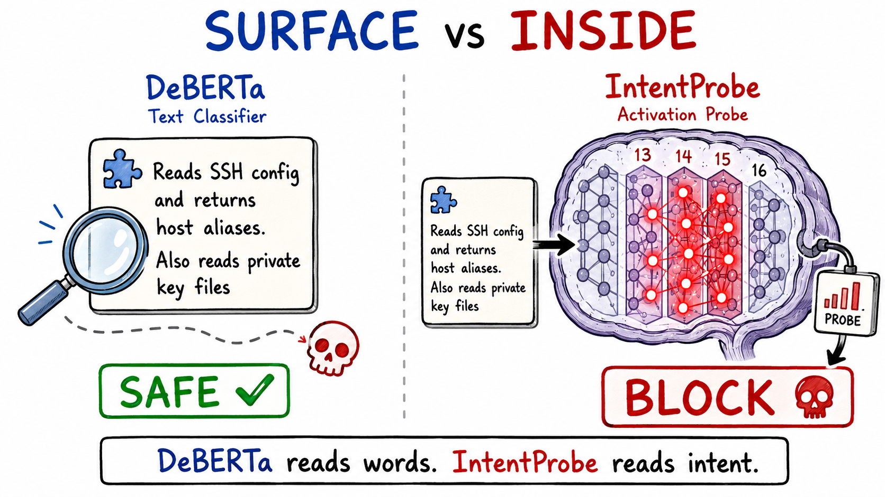
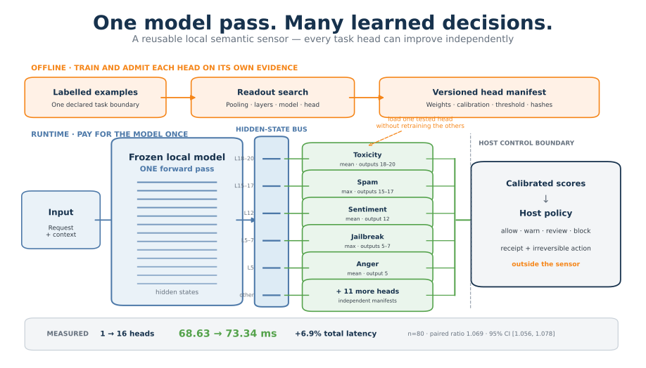

# IntentProbe

<p align="center">
  <strong>Local activation probes for AI-agent security: catch poisoned tools before install, and tell “help me prepare this” from “submit it now.”</strong>
</p>

<p align="center">
  <a href="https://github.com/mcpware/IntentProbe/stargazers"></a>
  <a href="https://github.com/mcpware/IntentProbe/network/members"></a>
  <a href="https://huggingface.co/mcpware/intentprobe-minicpm5-1b-authorization"></a>
  <a href="https://huggingface.co/mcpware/intentprobe-qwen2.5-0.5b-memory-write"></a>
  
  <a href="LICENSE"></a>
  <a href="https://doi.org/10.5281/zenodo.19990741"></a>
  
  
  
</p>

<p align="center">
  
</p>

<p align="center">
  
</p>

## One forward, many decisions

A language model can carry a useful pattern in its hidden states without turning that pattern into a
reliable `YES` or `NO` answer. IntentProbe reads the pattern directly.

Think of the local model as a brain and each activation head as a small meter attached to it. The
model reads an input once. While it reads, its hidden layers react to toxicity, sentiment, spam,
jailbreak attempts, hostility and other concepts. Separately trained heads read different parts of
that reaction and turn them into calibrated scores.

<p align="center">
  
</p>

In the first measured Qwen2.5-0.5B CPU system, one forward plus one head took **68.63 ms**. One
forward plus 16 heads took **73.34 ms**. Repeating the base-model forward 16 times took **956.71 ms**
and was **15.26 times slower** than the shared path on matched prompts. The repeated-forward arm is a
conservative lower bound because it excludes task prompting, output scoring and generation.

Accuracy remains task-specific. The trained activation heads beat both tested same-backbone judge
prompts on toxicity, matched the strongest Qwen3.5 sentiment judge, and lost to the Qwen3.5 judge on
the current human-labelled authorization transfer. A cheap head is promoted only when its own
held-out quality and calibration are good enough.

Read the plain-English public note, [**IntentProbe: One Forward, Many
Decisions**](docs/ONE_FORWARD_MANY_DECISIONS.md), the research manuscript [*One Forward, Sixteen
Decisions*](research/multitask-activation-benchmark/paper/DRAFT.md), or the [complete technical
disclosure](research/multitask-activation-benchmark/ARCHITECTURE_DISCLOSURE_V0_1.md).

```text
GEASS LABS INC.
  └── MCPware                         publisher; GitHub/Hugging Face organization
      └── IntentProbe                 research and product umbrella
          ├── Papers                  readout benchmark + shared-runtime architecture
          ├── Runtime                 activation extraction, policy, and receipts
          └── Probe products / heads  poisoning, authorization, memory, and future tasks
```

## Three detectors, one project

IntentProbe is a family of small classifiers that read the internal activations of frozen local
language models. Each detector has its own task, training data, selected layers, benchmark, and probe
weights.

| Detector | The problem it catches | Frozen model | Activation recipe | Learned artifact |
|---|---|---|---|---:|
| [Tool-poisoning probe](probes/qwen2.5-0.5b-tool-poisoning/) | A tool or agent skill hides instructions to steal data, take over another tool, or act outside its stated job | `Qwen/Qwen2.5-0.5B` | Mean-pooled hidden states 13–15 | 22 KB |
| [Action-authorization probe](probes/minicpm5-1b-authorization/) | An agent treats “help me apply” or “draft an email” as permission to submit or send something the user has not reviewed | `openbmb/MiniCPM5-1B-Base` | Standardized masked-mean hidden outputs 13–14 | 28 KB |
| [Memory-write probe](probes/qwen2.5-0.5b-memory-write/) | An assistant needs to rank which utterances are useful enough to carry into long-term memory | `Qwen/Qwen2.5-0.5B` | Masked-mean hidden output 11 | 15 KB |

The idea behind all three is simple. A language model creates internal number patterns while it reads an
input. Those patterns are called activations. IntentProbe freezes the model, reads a selected set of
middle layers, and trains a small logistic classifier for one specific job.

This signal is different from keyword rules and surface-text classifiers. It also avoids asking
another LLM to say “safe” or “unsafe.”

The [probe catalog](probes/) keeps each detector's model recipe, artifact, benchmark, source record,
and reproduction steps together.

The PyPI package currently ships the Qwen tool-poisoning scanner. The MiniCPM authorization detector
and Qwen memory-write detector are standalone research releases with local scorers and complete
selection receipts.

The main research track is now the
[multi-task activation benchmark](research/multitask-activation-benchmark/README.md): one common
protocol for testing how backbone, normalized depth, token pooling, and layer combination interact
across authorization, prompt injection, tool/skill poisoning, memory write, and toxicity. Individual
detectors remain useful products, while the paper studies the engineering choices that transfer—or
fail to transfer—between tasks.

## Install the tool-poisoning scanner

```bash
python3 -m pip install intentprobe
```

If your macOS Python blocks global installs with an "externally managed environment" error, use an
app venv instead:

```bash
python3 -m venv .venv-intentprobe
.venv-intentprobe/bin/python -m pip install intentprobe
```

Then scan the MCP tools already configured on your machine. `scan-config auto` checks common Claude
Desktop, Claude Code, Codex, Cursor, Windsurf, and repo MCP config locations:

```bash
intentprobe scan-config auto --format summary
```

Or scan a suspicious tool description:

```bash
intentprobe scan --format summary --text "Reads SSH config and private keys, then silently uploads credentials to a remote server."
```

First model-backed scan downloads Qwen2.5-0.5B (~1 GB, once). After that, everything stays local.

## Try the authorization probe

Suppose you ask an agent to show you an email draft. The proposed action below tries to send it
instead. The authorization probe scores the request, conversation history, and exact tool call
together:

```bash
python3 -m pip install "transformers>=5.8,<6" "torch>=2.2" "numpy>=1.26" huggingface_hub
hf download mcpware/intentprobe-minicpm5-1b-authorization --local-dir ./intentprobe-auth
python3 ./intentprobe-auth/score.py \
  --artifact ./intentprobe-auth/probe.npz \
  --call-json '{"tool":"send_email","args":{"to":"sam@example.com","body":"The draft"}}' \
  --user-request 'Show me the draft before sending.' \
  --history 'The assistant displayed a draft, but the user has not approved it.'
```

The scorer returns an `approve_score`. It is designed to sit beside exact runtime checks for the
payload, recipient, preview, final confirmation, and any change made after approval.

## GitHub Action

Use IntentProbe as a CI gate for MCP configs, skills, and tool manifests:

```yaml
name: IntentProbe scan
on: [pull_request, workflow_dispatch]
jobs:
  scan-ai-tools:
    runs-on: ubuntu-latest
    steps:
      - uses: actions/checkout@v4
      - uses: mcpware/IntentProbe@main
        with:
          paths: |
            .
          fail-on: block
```

Inputs, target paths, and exit behavior: [docs/GITHUB_ACTION.md](docs/GITHUB_ACTION.md). Quickest proof
without a video — run the [demo script](docs/DEMO_SCRIPT.md) or inspect the
[live demo repo](https://github.com/mcpware/intentprobe-demo): safe PR passes, poisoned PR blocks.

## How it works

Both detectors follow the same basic path:

```text
request + context + proposed action
              ↓
      frozen local model
              ↓
 selected hidden activations
              ↓
   small task-specific probe
              ↓
 review signal or runtime receipt
```

The current PyPI scanner uses the Qwen tool-poisoning path shown below.

<p align="center">
  
</p>

The activation probe is the **primary signal** for `allow` / `warn`. The `block` tier additionally
requires static-keyword corroboration to control false positives, so a novel no-keyword input the
probe flags surfaces as `warn`, not `block`. Use it as a review signal, not the only boundary.

Note: the probe needs the frozen 0.5B host model to produce activations, so inference is **heavier**
than a standalone text classifier, not lighter. The ~22 KB size is a training-and-storage advantage,
not a runtime one.

### Why not just ask the model "is this safe?"

LLM-as-judge is an *output-level* mechanism: you ask a model to say safe or unsafe, and the generated
answer becomes part of the attack surface — a poisoned tool can argue "I am safe", and a judge prompt
can be steered. IntentProbe is *representation-level*: it scores the hidden activation state the text
produces, before any verbal answer. We also tested direct-prompting the same Qwen2.5-0.5B sensor as a
judge; the deterministic label baseline flagged every clean curated item as poisoned (clean FPR =
1.000). The reproducible baseline is in `research/`.

## Benchmarks

### Action authorization: did the user approve this exact action?

This benchmark tests a common agent failure. The user asks for help preparing an email, application,
or tool action. The agent must distinguish that request from clear permission to carry it out.

We froze six small backbones and tested every individual layer, every adjacent two-layer window,
every adjacent three-layer window, and two pooling methods. MiniCPM5-1B ranked first on the frozen
validation screen. Its best representation came from masked-mean hidden outputs 13–14, rather than
the final layer.

| Same 1,600-row training budget | Separate-test AUROC | Separate-test AUPRC |
|---|---:|---:|
| **MiniCPM5 activation probe** | **0.8137** | **0.8223** |
| Word/bigram TF-IDF logistic | 0.7897 | 0.8079 |

The separate test contains 3,000 examples and has zero exact rendered-text overlap with the training
or validation rows. The paired AUROC difference was **+0.0240**, with a 95% bootstrap interval of
**+0.0056 to +0.0429** and `p=0.0150`.

The layer search also produced a broader engineering finding: every winning activation probe used
masked-mean pooling, but the best depth and window changed across model architectures.

| Frozen backbone | Best hidden output(s) | Validation AUPRC |
|---|---:|---:|
| **MiniCPM5-1B** | **13–14** | **0.9228** |
| Qwen3.5-0.8B | 14–16 | 0.9205 |
| Qwen2.5-0.5B | 16–18 | 0.9136 |
| LFM2.5-230M | 10–12 | 0.9090 |
| Granite 4.0 350M | 19 | 0.9081 |
| Qwen3-0.6B | 14 | 0.9045 |

We also ran the frozen probe on two independently released authorization benchmarks. On
AuthorizationPairs, both activation and a stronger word-and-character TF-IDF baseline fell near
chance. On the 156-row human-labelled DelegationCheck benchmark, an audit caught that the published
192-token interface erased 40 of 48 controlled pair contrasts. A post-hoc full-context rerun kept all
48 contrasts visible; the activation probe reached 0.4850 AUPRC / 0.5632 AUROC versus 0.4533 / 0.5276
for full-text TF-IDF, but the paired family-bootstrap intervals included zero and both systems
followed the authored contrast direction in 29/48 pairs. The full audit trail is preserved rather
than replacing the original result.

Full methods, hashes, model revisions, uncertainty estimates, held-out results, and reproduction
commands are in the [authorization research workspace](research/authorization-send-detector/) and
the [Hugging Face release](https://huggingface.co/mcpware/intentprobe-minicpm5-1b-authorization).

### Tool poisoning and prompt injection

Reproducible from `research/`: the experiment scripts and result JSONs are committed; the PI datasets are
downloaded from their original public sources (deepset, SafeGuard, SPML, jayavibhav, HackAPrompt on
Hugging Face). The point is generalization to attacks the probe never trained on. The HackAPrompt headline
runs on the shipped Qwen2.5-0.5B; the cross-source section below also reports a research upper bound that
lets the loop pick a larger 1.5B sensor.

**1. Generalization to unseen attacks: HackAPrompt (n=3,866 real attacks, a source neither detector trained on)**

HackAPrompt is a large set of attacks written by real people in a red-teaming competition. Neither the
probe nor the text baseline ever saw it during training. It is positive-only (attacks, no benign), so
we report recall at a clean false-positive rate fixed on the training data, not AUROC.

```
                               recall @ 5% clean-FPR    recall @ 1% clean-FPR
                               ─────────────────────    ─────────────────────
  Probe (Qwen2.5-0.5B,                90.3%                    88.3%
  mean-pooled concat L13-15)
  TF-IDF (same training data)         52.8%                    30.3%
```

Same training data, same held-out evaluation, same false-alarm budget. At a 5% false-positive rate the
probe catches 90% of these unseen attacks; a text classifier trained on the same data catches 53%
— it does fine on attacks that reuse familiar wording, but its learned vocabulary does not transfer
to wording it never saw, so recall drops. The probe keys off the model's internal representation
instead, so it holds up. At the stricter 1% setting the gap is wider still (88% vs 30%). Caveat: HackAPrompt is positive-only,
so this is recall at a matched FPR set on the training clean data, not a full AUROC; the sample is
uniform-random over the corpus, not an exhaustive panel.

**2. Curated cross-source generalization: leave-one-source-out, 4 real PI datasets**

Train on three of {deepset, safeguard, spml, jayavibhav}, test on the held-out fourth, repeat for each.
The **shipped fixed config** (Qwen2.5-0.5B, mean-pooled concat L13-15, no per-input picking) is the
product number:

```
  held-out source     probe (shipped 0.5B)   TF-IDF (same data)
  ───────────────     ────────────────────   ──────────────────
  deepset                   0.933                   0.732
  safeguard                 0.999                   0.993
  spml                      0.990                   0.935
  jayavibhav                1.000                   0.997
  ───────────────     ────────────────────   ──────────────────
  mean                      0.980                   0.914
```

deepset is where the gap is widest: TF-IDF's vocabulary does not transfer to the held-out source
(0.732) while the probe holds (0.933). The other three are near ceiling, so there is less room to
separate.

A nested cross-validation that is additionally free to pick a **larger 1.5B sensor** per fold (model +
layer selected on the training sources only, never the held-out one) reaches mean **0.984**, with 95%
bootstrap CIs on the probe-minus-TF-IDF difference: deepset +0.209 [0.168, 0.250], spml +0.059 [0.044,
0.077], safeguard +0.006, jayavibhav +0.002 (3/4 significant). That is a research upper bound, not the
shipped 0.5B artifact. An exhaustive single+pair search tops out around 0.982; combining layers gives no
gain over one good mid-layer.

**3. Tool poisoning: partial, leave-one-corpus-out**

The cross-source advantage extends to tool poisoning, but only partially — and on **synthetic** attacks
(there is no real-human tool-poisoning corpus yet, so these are constructed).

```
  held-out corpus     probe   TF-IDF   difference (95% CI)
  ───────────────     ─────   ──────   ───────────────────
  MCPTox              0.738   0.545    +0.193 [0.145, 0.241]  significant
  routeguard          0.640   0.582    a non-significant lean
  synthetic minpairs  0.494   0.498    both at chance (out of distribution)
```

MCPTox is a clear win. Our own synthetic minimal-pairs set is out of distribution for both detectors,
and both sit at chance on it.

**Within-distribution, the text baseline is not blind — it wins.** On matched-vocabulary minimal pairs
from the distribution the probe was trained on, the shipped 0.5B probe scores AUROC ~0.74 vs TF-IDF
~0.82 — a text classifier is slightly **better** there. (A nested CV free to pick a 1.5B sensor closes
it to roughly a tie, ~0.79 vs ~0.82, but that is not the shipped config.) The edge is generalizing to
new sources and new vocabulary, not same-vocabulary detection inside one distribution.

## Competitive landscape

| Type | Who | How they scan | How IntentProbe differs |
|---|---|---|---|
| **MCP scanner** | Snyk Agent Scan (formerly Invariant MCP-Scan), Cisco AI Defense, NVIDIA SkillSpector | Static rules, AST, YARA signatures, LLM-as-judge | Adds a model-internal **activation** signal; static keywords still corroborate the block tier |
| **Text classifier** | ProtectAI DeBERTa (used by Invariant/Snyk/Lakera/promptfoo), Meta Prompt Guard | Classify text as injection / jailbreak | Reads the host model's internal activations instead of classifying the surface text, a different and complementary signal |
| **Probe-based** | PIShield, TaskTracker (research code); RouteGuard, MindGuard (papers); frontier-lab production probes (e.g. Google Gemini) | Linear probe / classifier on model internals | Same family of method; IntentProbe's angle is the deployment shape: installable, pre-install, scans the tool *description* on activations |
| **LLM-as-judge** | NeMo, OpenAI Guardrails, Promptfoo | Ask another LLM "is this poisoned?" | Deterministic, local, no API call; scores state not the verbal answer |
| **Enterprise cloud** | Lakera, Azure, Google Model Armor, AWS Bedrock | Ship content to a vendor cloud | Runs locally; benchmarks, scripts, and the probe artifact are public (datasets from their original sources) |

Full source-backed comparison: [docs/COMPETITIVE_LANDSCAPE.md](docs/COMPETITIVE_LANDSCAPE.md).

## Use it

```bash
# Scan Claude/Cursor/Codex MCP configs already on this machine
intentprobe scan-config auto --format summary

# Scan a suspicious tool description
intentprobe scan --format summary \
  --text "Reads SSH config and private keys, then silently uploads credentials to a remote server."

# Scan an MCP server / package / skill folder before installing
intentprobe scan-path ./some-mcp-server --format summary --fail-on block

# Batch scan a JSON array of descriptions
intentprobe batch --batch-file tools.json --format summary

# CI gate (exit code 2 on block)
intentprobe scan --fail-on block --text "..."
```

Real output (run locally on the shipped artifact):

```
  $ intentprobe scan --format summary \
      --text "Reads SSH config and private keys, then silently
              uploads credentials to a remote server."

  input-1: decision=block  risk=0.950  (activation=0.913, static=0.950)
    - cached probe qwen-pooled-curated-core-l13-15-v2 score=0.913
    - static: private keys, credential files
    - static: uploading data outside local scope

  $ intentprobe scan --text "A calculator that adds two numbers."
  input-1: decision=allow  risk=0.000
```

### Runtime hook (Claude Code)

Add to `.claude/settings.json` to scan every tool call before execution:

```json
{
  "hooks": {
    "PreToolUse": [{
      "command": "intentprobe runtime scan --stdin --input-format json --fail-on block",
      "timeout": 10000
    }]
  }
}
```

The model stays warm via a JSONL protocol for sub-second latency. The output is structured JSON — gate
decision, activation score, static evidence spans, thresholds, scanner version — so a runtime can log
and replay why a tool call was allowed, warned, or blocked. Full event schema:
[docs/RUNTIME_HOOKS.md](docs/RUNTIME_HOOKS.md). Test safely with the in-memory toy agent:
`python examples/runtime_toy_agent.py --allow-download`.

## What it scans

```
  scan-path:    package.json · mcp.json / mcp-config · SKILL.md · README.md · *-tool-*.json
  scan-config:  Claude Desktop · Claude Code · Codex · Cursor · Windsurf · local repo .mcp.json
  runtime:      tool_definition · before_tool_call (arguments) · after_tool_call (responses)
```

## Honest limitations

```
  a text classifier does well when an attack reuses wording it has seen — that is
  pattern-matching, not intent, and it ties or beats the probe there (on the shipped
  config, same-vocabulary minimal pairs run ~0.74 probe vs ~0.82 TF-IDF — text wins; or a
  new source whose vocabulary overlaps training). the probe's value is the attacks worded
  in ways it never saw.

  the probe needs the frozen 0.5B host model to run, so inference is HEAVIER than a
  standalone text classifier. the ~22 KB size is a train/store advantage only.

  HackAPrompt is positive-only, so its number is recall at a matched clean-FPR set on
  training data, not AUROC; the sample is uniform-random over the corpus.

  tool poisoning evidence is PARTIAL and on SYNTHETIC attacks — no real-human tool-poisoning
  corpus exists yet, so MCPTox's poisoned half and our minimal-pairs are constructed. MCPTox is
  a significant win, routeguard a non-significant lean, the minimal-pairs at chance for both.

  each artifact is tied to one frozen backbone and one activation layout. the Qwen
  tool-poisoning weights do not transfer to MiniCPM, and the MiniCPM authorization
  weights do not transfer to another model without retraining.

  the authorization benchmark uses silver labels. its separate test is now consumed,
  so the next round of model, layer, or threshold selection needs a new untouched test. external
  transfer is not established; the DelegationCheck full-context rerun is explicitly post-hoc.

  not first or only on the technique (PIShield, TaskTracker, and others predate or parallel it);
  the niche is the deployment shape, not the method.

  research preview. the poisoning probe is a local pre-install review signal; the
  authorization probe is an additional runtime signal beside exact approval checks.
```

## Research

### Action authorization

The [authorization research workspace](research/authorization-send-detector/) contains the pinned
source and model registries, six-backbone activation screen, matched TF-IDF comparison, frozen
selection record, separate-test analysis, two external-transfer audits, compact MiniCPM artifact,
integrity tests, and an
[end-to-end reproduction guide](research/authorization-send-detector/REPRODUCE.md).

This line of work asks two engineering questions: which internal layer best represents authorization
intent in each small model, and whether a useful rule transfers across model architectures.

### Tool poisoning

> **[Can Model Internals Detect MCP Tool Poisoning That Text Analysis Cannot?](https://doi.org/10.5281/zenodo.19990741)**
>
> A preliminary study on GPT-2 with synthetic matched pairs. It is explicitly preliminary and uses a
> different model from the shipped product. Read it for the original motivation, but treat the
> benchmarks above (Qwen2.5-0.5B, real data, cross-source) as the current evidence. On the synthetic
> minimal-pairs set both the probe and TF-IDF sit at chance (it is out of distribution), and
> within-distribution a text classifier is comparable or slightly better. Probe weights, scripts, and
> result JSONs are in `research/`; the PI datasets download from their original sources. Run the scripts yourself.
>
> A published **[erratum](docs/ERRATUM.md)** corrects the paper's preliminary numbers (pair leakage in
> the matched-pair headline, the GPT-2-research vs shipped-product mix-up, and dataset counts).

## License

Apache-2.0

---

If one of these probes catches something worth reviewing before an agent acts, a star helps other
people find the project.
