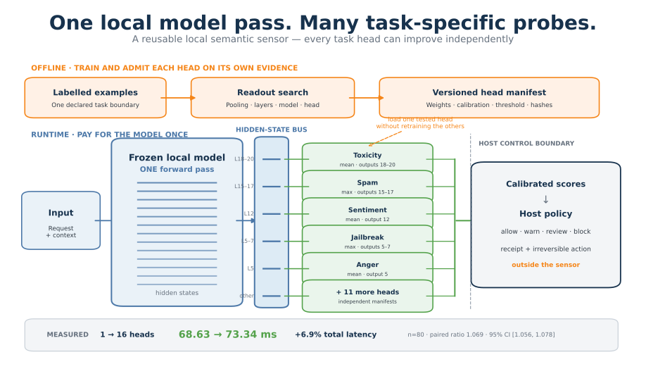

# One local model pass. Many task-specific probes.

IntentProbe uses **activation probes** to turn a small local language model's hidden states into
task scores. One forward pass can feed many independently trained heads for guardrail and
classification checks, without generating a separate answer for each check.

[Read the architecture article]({{ '/architecture/' | relative_url }}) ·
[Get the models on Hugging Face](https://huggingface.co/mcpware) ·
[GitHub and reproduction code](https://github.com/mcpware/IntentProbe)

## A CPU sidecar for agent workflows

An agent turn may need several checks: toxicity, jailbreak, sentiment, permission to act, or what
to remember. A local sensor model can read the input once while small heads each score a declared
task. Every compatible head shares that model pass and keeps its own data, readout recipe, and
threshold.

Beside a hosted agent, the sidecar runs its own local pass. It does not require access to Claude,
Codex, or another hosted model's hidden states. With a local agent model, heads trained for that
backbone can attach directly to its pass.

## The measured shared runtime

On one six-core CPU, one Qwen2.5-0.5B forward plus one head averaged **68.63 ms**. The same shared
path with 16 heads averaged **73.34 ms**: **6.9%** more mean latency across 80 held-out texts per K,
with a paired 95% ratio interval of **[1.056, 1.078]**. The 16-head suite covers toxicity, jailbreak,
spam, sentiment, emotion, and conversational pragmatics.

[See the complete result and protocol](https://github.com/mcpware/IntentProbe/tree/main/research/multitask-activation-benchmark/experiments/ONE-FORWARD-MULTIHEAD-EXP001).
It measures shared inference cost; each task has its own quality evaluation.

## Try a probe

| Probe | Local model | Start here |
|---|---|---|
| Tool poisoning | Qwen2.5-0.5B | [Model and installation](https://huggingface.co/mcpware/intentprobe-qwen2.5-0.5b) |
| Action authorization | MiniCPM5-1B | [Model and scorer](https://huggingface.co/mcpware/intentprobe-minicpm5-1b-authorization) |
| Memory write | Qwen2.5-0.5B | [Model and scorer](https://huggingface.co/mcpware/intentprobe-qwen2.5-0.5b-memory-write) |

The PyPI package ships the tool-poisoning scanner. Authorization and memory write have standalone
research scorers. The shared 16-head runtime is reproducible research code; its general registry
and hot-loading interface are specified next steps.

## Read, reproduce, cite

- [Architecture preprint and DOI](https://doi.org/10.5281/zenodo.23467859).
- [Plain-English architecture article]({{ '/architecture/' | relative_url }}): the design and examples.
- [Research manuscript](https://github.com/mcpware/IntentProbe/blob/main/research/multitask-activation-benchmark/paper/DRAFT.md): methods and results.
- [Technical specification](https://github.com/mcpware/IntentProbe/blob/main/research/multitask-activation-benchmark/ARCHITECTURE_DISCLOSURE_V0_1.md): components and interfaces.
- [Citation metadata](https://github.com/mcpware/IntentProbe/blob/main/CITATION.cff): author, version, and references.
- [Machine-readable project context]({{ '/llms.txt' | relative_url }}).

Published by **MCPware**, a product and research brand of GEASS LABS INC.
Public author: [ithiria894](https://github.com/ithiria894). Architecture first published 18 October 2026.
