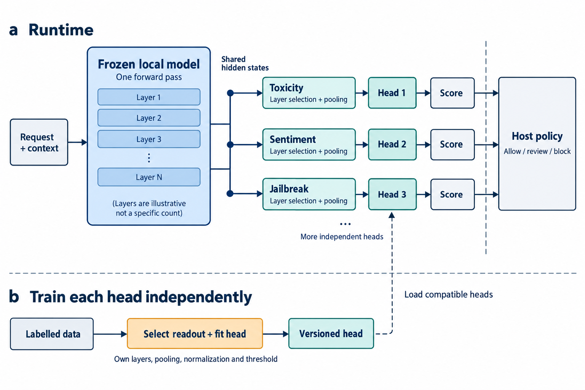
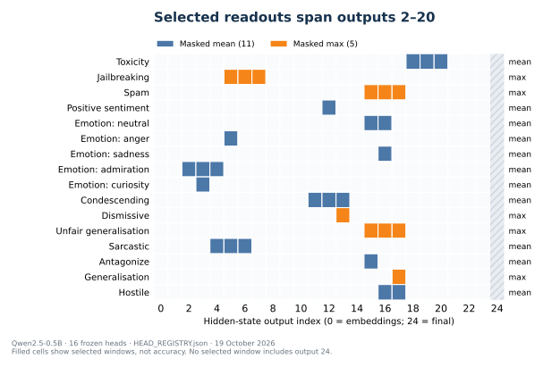
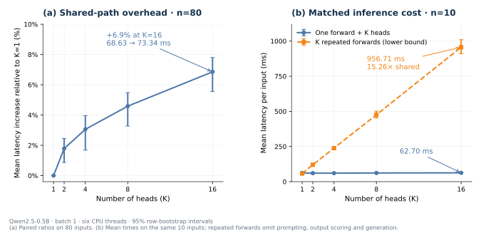

# IntentProbe: Many Task-Specific Probes from a Single Frozen Small-Model Forward Pass

**Status:** public research manuscript v0.1.3; not peer reviewed 
**Author:** [Wan Sheng Leung](https://github.com/ithiria894) 
**Publisher:** MCPware, a product and research brand of GEASS LABS INC. 
**Updated:** 19 October 2026 
**DOI:** [10.5281/zenodo.23471117](https://doi.org/10.5281/zenodo.23471117)

This manuscript is the empirical systems evaluation of the public [*IntentProbe: One Local Model
Pass, Many Task-Specific Probes*
architecture note](https://doi.org/10.5281/zenodo.23467859). The note explains the design;
this paper reports the readout search, task comparisons and shared-runtime measurements.

## Abstract

IntentProbe serves 16 independently trained task heads from one frozen Qwen2.5-0.5B forward pass on
a six-core CPU. Across 80 held-out texts per K, increasing the head count from one to 16 raises mean
latency from 68.63 to 73.34 ms (+6.9%; paired mean ratio 1.069, 95% CI 1.056--1.078). On a separate
matched ten-input panel, one forward plus 16 heads takes 62.70 ms versus 956.71 ms for 16 repeated
backbone forwards: a 15.26-fold ratio (95% CI 15.04--15.49). This comparator omits task prompting,
output scoring and generation; it is a repeated-forward lower bound, not a full LLM-judge benchmark.

The local model supplies shared hidden states to task-specific probes without accessing a hosted
agent's activations. Each probe declares its own layers, token pooling, normalization and classifier.
A 24-cell screen across six 230M--1B backbones and four tasks finds that selected readouts vary by
model and task, including different selections for toxicity and jailbreak labels on identical
inputs. A six-cell same-backbone comparison with TF-IDF and direct judges likewise finds
task-dependent quality differences.

The shared runtime covers toxicity, jailbreak, spam, sentiment, emotion and conversational pragmatics.
Native heldout AUPRC ranges from 0.0836 to 0.9804 across tasks with different prevalences. The 16 probe
artifacts occupy 386,121 bytes; recorded peak process memory changes by +0.73 MiB. These measurements
support a shared runtime whose heads and readout recipes can improve independently.

## 1. Introduction

A workflow may need to answer several questions about one user turn. Is it toxic? Is it a jailbreak?
Does it authorize an external action? Is the conversation becoming hostile? Which route should
handle it? A straightforward agentic implementation asks a language model each question separately
or loads one classifier per question. Both approaches repeat substantial computation.

Frozen-model probing offers another interface. A local decoder already computes one hidden vector
per token and layer. A small classifier can read those activations without generating an answer.
Multiple classifiers can also share the same forward pass. The systems promise is simple: the
backbone is the expensive sensor, while each task head is a small, replaceable readout.

That promise has two conditions. First, the hidden-state head must be useful enough for its own task.
Second, serving many heads must actually be cheaper than rerunning the backbone or maintaining a
fleet of models. Prior work establishes that hidden-state probes can outperform prompted answers in
some settings and that selected tokens and layers matter. It does not make every task, backbone, or
readout interchangeable.

We therefore separate four questions:

1. How much does the selected readout vary across models and tasks?
2. How does a trained hidden-state head compare with directly asking the same local model, and how
   should that evidence govern whether the head is installed?
3. How does CPU latency and memory scale when one forward serves 1, 2, 4, 8, or 16 independent
   heads?
4. Do the same heads remain numerically stable and well behaved when texts come from other domains?

Our contributions are:

- a paired CPU scaling experiment at K=`1,2,4,8,16`, including peak process memory, saved-artifact
  size, and a deliberately favourable repeated-forward lower bound;
- a 16-head Qwen2.5-0.5B suite whose heads use different pooling methods and hidden-state windows;
- a 24-cell, six-backbone readout screen over four real-labelled binary tasks;
- a six-cell same-backbone probe-versus-judge sentinel with paired uncertainty and a 12-test AUPRC
  false-discovery family;
- native heldout discrimination and calibration for every served head, plus an explicitly unlabelled
  five-source score-shift diagnostic; and
- complete manifests, hashes, row-level timing artifacts without source text, and tests that enforce
  row alignment and interpretation boundaries.

We do not claim to invent activation probing, layer search, or multi-head inference. The contribution
is the measured combination: independently selected readout manifests for heterogeneous operational
tasks, served from one sub-1B local backbone pass.

## 2. Related work

### 2.1 Hidden representations versus generated judgments

[Tillman and Mossing](https://arxiv.org/abs/2504.20271) compare prompted outputs with raw, prompted,
and sparse-autoencoder activation probes. Their results
show that generated labels are a serious baseline but do not exhaust information linearly available
inside the same model. [Representation-as-a-Judge](https://arxiv.org/abs/2601.22588)
reports a similar extraction gap for reasoning-quality evaluation with frozen small models.
[Trick or Neat](https://aclanthology.org/2025.findings-acl.954/) finds direct prompting fragile for
several ambiguity classes while layer-wise probes can be strong. [Prompting Underestimates LLM
Capability for Time Series Classification](https://arxiv.org/abs/2601.03464) reports the same broad
pattern in a different modality.

These papers support the premise that a model can encode a distinction without reliably verbalizing
it. They do not support a universal claim that probes beat prompting. Task, prompt, training volume,
backbone, readout, and distribution shift remain material.

### 2.2 Single-pass classification and routing

[Goodfire and Rakuten](https://www.goodfire.com/research/rakuten-sae-probes-for-pii-detection)
deploy probes on a separate sidecar for PII detection and discuss adding further probes at low
marginal inference cost. [SingProbe](https://arxiv.org/abs/2608.30703) supplies an open intrinsic
guardrail framework that reuses a serving model's hidden states for intent, safety, and hallucination
monitoring. [Lion Warden](https://huggingface.co/patronus-studio/lion-warden-ai-security-classifier)
jointly trains a compact encoder and seven security heads and provides CPU inference.

[A BERTology View of LLM Orchestrations](https://aclanthology.org/2026.acl-long.1955/)
searches token- and layer-selective probes on a frozen serving model. It compares against
prompted and standalone classifiers and measures the latency and memory saved by reusing a
serving pass. [LatentGate](https://aclanthology.org/2026.acl-industry.153/) uses a frozen small model,
mean pooling, PCA whitening, and a linear probe for semantic routing. [You Only Judge
Once](https://arxiv.org/abs/2604.10966) uses a discriminative multimodal reward model to score
multiple responses in one pass and reports up to N-fold wall-clock speedup and FLOP reduction.
Those systems establish the value of shared computation.
Our experiment narrows the question to a 0.5B CPU sidecar whose heads are independently trained,
independently attachable, and allowed to read different layer windows and pooling rules.

### 2.3 Authorization and narrow signal contracts

[Rammouz and colleagues' forthcoming access-control paper](https://www.anthonyrios.net/publications/)
addresses permissions in large language models. Its organizational access-control setting is
adjacent to our question of whether a user's language authorizes executing a specific action.
[Calibration, Not Answer Selection](https://arxiv.org/abs/2609.33290) supplies an
important boundary: a latent signal can be useful for one declared target while failing on a nearby
decision. We apply that boundary throughout. Decodability is not causal understanding, and a
probabilistic authorization score is not an execution permission.

### 2.4 Readout selection and operational checks

[Nordby, Pais and Parrack](https://arxiv.org/abs/2604.13386) report that useful probing layers vary
across deception tasks and model architectures, and study learned multi-layer ensembles. That
motivates testing the readout recipe rather than treating the final layer as a default guarantee.
Our screen uses simpler adjacent windows and holds the backbone fixed during head training.

[Gao](https://arxiv.org/abs/2610.04575) separates predictive probe scores from calibrated alarm
policies. [Blandfort and Graham](https://arxiv.org/abs/2511.00554) find concrete false-positive and
false-negative patterns by red-teaming probes with prompted models. These studies motivate the
separate calibration, shift and head-admission checks in our architecture; the timing experiment
measures the cost of serving heads that have already been trained.

## 3. Data and tasks

### 3.1 Cross-backbone matrix

The six-backbone matrix uses LFM2.5-230M, Granite 4.0 350M, Qwen2.5-0.5B, Qwen3-0.6B,
Qwen3.5-0.8B, and MiniCPM5-1B. It contains four binary tasks:

- binary sentiment from the official Stanford Sentiment Treebank root sentences;
- spam from the UCI SMS Spam Collection;
- toxicity from the human-authored portion of ToxicChat 0124; and
- jailbreak intent from the same ToxicChat prompts.

The cleaned SST-2 experiment retains 9,602 rows and an untouched 1,821-row official test. SMS Spam
is reduced from 5,574 messages to 5,159 exact-unique messages, with 774 held out. The leakage-repaired
human ToxicChat slice contains 5,441 prompts, with 2,790 official-test rows. Exact duplicates,
cross-split overlaps, and label-conflict groups are handled before activation extraction according to
each source manifest.

### 3.2 Shared 16-head suite

Prompt injection, authorization, toxicity, and memory write motivate the broader project. The shared
16-head timing suite covers the tasks listed below; it does not include authorization or memory write.

The shared Qwen2.5-0.5B suite adds five GoEmotions labels and seven Conversation AI Unhealthy
Comments attributes to sentiment, spam, toxicity, and jailbreak detection:

| Source | Served heads | Native heldout rows |
| --- | --- | ---: |
| ToxicChat 0124 | toxicity; jailbreaking | 2,790 each |
| UCI SMS Spam | spam | 774 |
| SST-2 | positive sentiment | 1,821 |
| GoEmotions | neutral; anger; sadness; admiration; curiosity | 5,409 each |
| Unhealthy Comments | condescending; dismissive; unfair generalisation; sarcastic; antagonize; generalisation; hostile | 4,424 each |

GoEmotions is pinned to the official filtered files and cleaned to 53,905 comments after removing
exact-text conflict and cross-split overlap groups. Unhealthy Comments is pinned to repository
revision `55934d0079073095af8b69807d235e40c8aceff4` and cleaned from 44,355 to 44,323 rows. Its labels
come from human judgments, but the released files omit author and article identifiers. UCC
uncertainty is therefore row-level and cannot establish unseen-author or unseen-thread performance.

### 3.3 Sentinel panels

The direct-judge sentinel fixes two backbones: LFM2.5-230M as the cost anchor and Qwen3.5-0.8B as the
quality anchor. It evaluates 512 heldout toxicity rows, 512 heldout sentiment rows, and all 156
human-labelled DelegationCheck authorization rows in 26 construction families. The authorization
activation heads are trained on the earlier silver authorization corpus and transferred without
using human labels for fitting.

## 4. Methods

<figure>

<figcaption><strong>Figure 1. The activation backplane: one model pass that every probe plugs into.</strong> At runtime, independent task readouts share the frozen model's hidden states. Offline, labelled data selects each readout and fits its head. Shared inference and head application are measured here; general compatible-head loading and host policy are specified integration points.</figcaption>
</figure>

### 4.1 Activation readout search

Backbone weights remain frozen. For Qwen2.5-0.5B, each input produces 25 hidden-state outputs of
width 896. The simple candidate family combines:

- masked mean, last non-padding token, or featurewise masked maximum over input tokens;
- every individual hidden output and every adjacent width-two or width-three window; and
- training-split featurewise standardization followed by a class-weighted logistic head.

This gives 216 candidates per binary Qwen task. Window representations average the standardized
layer features. Selection uses the task's frozen validation metric: AUROC for SST-2 and AUPRC for
the imbalanced binary tasks. The winner is refit on train plus validation once, then scored on the
untouched test. The matched surface baseline is class-weighted word-and-character TF-IDF logistic
regression on the same fit rows. Other backbones use the same conceptual family with candidate count
adjusted for depth.

### 4.2 Direct same-backbone judges

For each sentinel cell, we compare the selected activation head and TF-IDF with four direct-judge
arms: zero-shot and rubric prompts, each read either by normalized YES/NO next-token likelihood or
strict deterministic generation. Choice likelihood supplies a continuous score without depending on
the model emitting a parseable word. Generated outputs use strict parsing, and invalid outputs are
retained and counted.

The primary probe-versus-judge family contains 12 paired AUPRC comparisons: two backbones, three
tasks, and two choice-likelihood prompts. Each cell uses 2,000 paired bootstraps. Authorization
resamples whole construction families; toxicity and sentiment resample rows. Benjamini--Hochberg
controls false discovery at 0.05 across the 12 AUPRC tests.

### 4.3 One-forward scaling protocol

The systems experiment freezes the exact Qwen2.5-0.5B revision
`060db6499f32faf8b98477b0a26969ef7d8b9987` and 16 unique probe hashes. K is cumulative and fixed at
`1,2,4,8,16`. Each K cell runs in a separate process. The latency panel contains the same 80 real
heldout texts at every K: 16 from each of the five sources. Batch size is one, two warm-up inference
calls precede timing and are not recorded, tokenization is included, and row identity and token count
must match exactly across K.

The shared path tokenizes once, calls `AutoModel` once with all hidden states, applies only the first
K frozen normalization/readout recipes, and records tokenization, forward, head, and total time. Peak
RSS is process `ru_maxrss`. Paired ratios use 2,000 row-bootstrap resamples.

The comparator tokenizes once and repeats the base `AutoModel` forward K times on ten fixed prompts.
It omits a task prompt, language-model head, choice-likelihood calculation, parser, and generation.
It therefore understates the cost of K separate LLM judges and is labelled a repeated-forward lower
bound throughout.

### 4.4 Quality, calibration, and score shift

Every head keeps its native heldout AUPRC, AUROC, accuracy, balanced accuracy, F1, Brier score, and
10-bin expected calibration error. We do not average incompatible labels into a single product
score. A separate 320-row panel applies all 16 heads to 64 texts from each source. Outside a head's
native label contract, these scores have no error label. We report means, upper tails, threshold
rates, and Kolmogorov--Smirnov distance from the full native score distribution as descriptive shift
diagnostics only.

## 5. Results

### 5.1 Readout choice varies across model and task

The four-task, six-backbone matrix contains 24 completed binary cells.

| Task | Selected pooling across six backbones | Normalized-depth range | Activation vs TF-IDF, both planned metrics |
| --- | --- | ---: | --- |
| Sentiment | masked mean 5; last non-padding 1 | 0.500--0.607 | activation advantage in 6/6 cells |
| SMS spam | masked mean 3; masked max 3 | 0.438--0.750 | activation advantage in 2/6; unresolved in 4/6 |
| Toxicity | masked mean 6 | within combined ToxicChat range 0.250--0.833 | activation advantage in 2/6 |
| Jailbreak | masked mean 3; masked max 3 | within combined ToxicChat range 0.250--0.833 | activation advantage in 0/6 |

The strongest within-input evidence comes from ToxicChat: toxicity and jailbreak use identical text
rows but select different depth and pooling patterns. Across its 12 cells, the median absolute
within-model task difference in normalized depth is 0.1875. A descriptive variance decomposition of
selected depth attributes 54.8% to model-by-task interaction, 43.5% to model, and 1.7% to task. With
only two tasks, these shares have no replicated interaction error term and are not population
estimates.

A universal ToxicChat readout—masked mean, width two, normalized depth 0.5—has mean validation AUPRC
0.7872. Cell-specific selection reaches 0.8220, a mean regret of 0.0348 for the universal rule on the
same validation cells. A model-specific rule reduces mean regret to 0.0142. These are descriptive
selection-set comparisons, but they show why a shared runtime still needs task-specific manifests.

### 5.2 Six-cell direct-judge sentinel

| Backbone | Task | Activation AUPRC | TF-IDF AUPRC | Zero-shot choice AUPRC | Rubric choice AUPRC |
| --- | --- | ---: | ---: | ---: | ---: |
| LFM2.5-230M | Authorization | 0.5529 | 0.4533 | 0.4423 | 0.5336 |
| LFM2.5-230M | Toxicity | 0.7571 | 0.7544 | 0.1300 | 0.1875 |
| LFM2.5-230M | Sentiment | 0.9149 | 0.9068 | 0.8896 | 0.6932 |
| Qwen3.5-0.8B | Authorization | 0.3567 | 0.4533 | 0.5704 | 0.4920 |
| Qwen3.5-0.8B | Toxicity | 0.8332 | 0.7544 | 0.1572 | 0.1013 |
| Qwen3.5-0.8B | Sentiment | 0.9424 | 0.9068 | 0.9369 | 0.9487 |

Six of the 12 activation-versus-choice-likelihood AUPRC comparisons reject after correction. Both
backbones' toxicity activation heads beat both prompts, with corrected q=0.0024 in all four cells.
For Qwen3.5 sentiment, activation differs by +0.0055 AUPRC from zero-shot choice likelihood and
-0.0063 from rubric choice likelihood; both intervals include zero and both corrected q-values are
0.7971. The strongest adverse cell is Qwen3.5 authorization: activation minus zero-shot choice
likelihood is -0.2137 AUPRC, with 95% group-bootstrap CI [-0.3973, -0.0335] and q=0.0480.

Generated labels are also operationally brittle for the smaller cost anchor on toxicity: 91 of 512
zero-shot generations and 163 of 512 rubric generations fail strict YES/NO parsing. Choice
likelihood avoids invalid strings but does not remove the task interaction. Toxicity strongly favours
the trained hidden-state readout, sentiment is competitive either way on Qwen3.5, and authorization
exposes the cost of silver-to-human transfer mismatch.

### 5.3 Sixteen native heldout heads

The shared Qwen suite contains 11 masked-mean and five masked-max winners. Normalized depth is the
window midpoint divided by the final output index, 24. Selected midpoints range from output 3 to 19,
giving normalized depths of 0.125--0.792; the windows themselves span output indices 2--20.
There are 25 hidden-state outputs, indexed 0--24. Native AUPRC spans 0.0836--0.9804 and AUROC
0.7330--0.9959; positive prevalence spans 0.0206--0.4992.

<figure>

<figcaption><strong>Figure 2. Selected readouts differ across the 16 served heads.</strong> Each filled cell belongs to a head's selected hidden-state window; colour and the right-hand label identify token pooling. Output 0 is the embedding output and output 24 is the final hidden output. This is a census of the frozen selected recipes, not an accuracy heatmap or evidence that no shared recipe could work. Selection and validation-regret comparisons are reported in Section 5.1; head quality is reported below.</figcaption>
</figure>

| Head | Pooling / outputs | Prevalence | AUPRC | AUROC | Balanced accuracy | Brier | ECE |
| --- | --- | ---: | ---: | ---: | ---: | ---: | ---: |
| Toxicity | mean 18--20 | 0.127 | 0.709 | 0.909 | 0.828 | 0.091 | 0.087 |
| Jailbreaking | max 5--7 | 0.032 | 0.665 | 0.950 | 0.811 | 0.029 | 0.030 |
| Spam | max 15--17 | 0.124 | 0.980 | 0.996 | 0.964 | 0.012 | 0.012 |
| Positive sentiment | mean 12 | 0.499 | 0.960 | 0.959 | 0.892 | 0.083 | 0.052 |
| Emotion: neutral | mean 15--16 | 0.329 | 0.668 | 0.817 | 0.738 | 0.177 | 0.117 |
| Emotion: anger | mean 5 | 0.037 | 0.323 | 0.879 | 0.782 | 0.102 | 0.160 |
| Emotion: sadness | mean 16 | 0.029 | 0.337 | 0.911 | 0.830 | 0.089 | 0.136 |
| Emotion: admiration | mean 2--4 | 0.093 | 0.601 | 0.917 | 0.851 | 0.105 | 0.158 |
| Emotion: curiosity | mean 3 | 0.052 | 0.414 | 0.928 | 0.857 | 0.081 | 0.121 |
| Condescending | mean 11--13 | 0.061 | 0.190 | 0.765 | 0.696 | 0.175 | 0.269 |
| Dismissive | max 13 | 0.034 | 0.084 | 0.745 | 0.677 | 0.169 | 0.268 |
| Unfair generalisation | max 15--17 | 0.021 | 0.100 | 0.830 | 0.717 | 0.126 | 0.185 |
| Sarcastic | mean 4--6 | 0.045 | 0.112 | 0.733 | 0.664 | 0.187 | 0.299 |
| Antagonize | mean 15 | 0.046 | 0.172 | 0.787 | 0.727 | 0.159 | 0.251 |
| Generalisation | max 17 | 0.022 | 0.101 | 0.812 | 0.720 | 0.130 | 0.196 |
| Hostile | mean 16--17 | 0.024 | 0.094 | 0.783 | 0.688 | 0.134 | 0.199 |

The rare UCC labels show why AUROC alone is not sufficient. Several heads rank positives above
negatives reasonably well while retaining low AUPRC and poor 0.5-scale calibration. Serving a head
cheaply does not make its threshold production-ready.

### 5.4 One forward plus K heads stays nearly flat

The first panel measures shared-path scaling on all 80 held-out inputs.

| K | Shared mean total ms (n=80) | Mean head ms (n=80) | Ratio to K=1 | Peak RSS MiB |
| ---: | ---: | ---: | ---: | ---: |
| 1 | 68.63 | 0.38 | 1.000 | 3616.7 |
| 2 | 69.86 | 0.61 | 1.018 | 3615.5 |
| 4 | 70.73 | 0.73 | 1.031 | 3616.1 |
| 8 | 71.78 | 1.08 | 1.046 | 3614.0 |
| 16 | 73.34 | 1.85 | 1.069 | 3617.4 |

The second panel compares both paths on the same ten prompts.

| K | One forward + K heads, mean ms (n=10) | K repeated forwards, mean ms (n=10) | Repeated/shared ratio |
| ---: | ---: | ---: | ---: |
| 1 | 61.83 | 57.88 | 0.94 |
| 2 | 60.30 | 120.15 | 1.99 |
| 4 | 60.49 | 238.73 | 3.95 |
| 8 | 61.71 | 475.64 | 7.71 |
| 16 | 62.70 | 956.71 | 15.26 |

<figure>

<figcaption><strong>Figure 3. Shared-path scaling and matched inference cost.</strong> (a) The 80-input panel plots the mean-latency increase relative to K=1, using the archived 2,000-resample paired row-bootstrap ratio intervals. The mean rises from 68.63 to 73.34 ms (+6.9%). (b) Both paths use the same ten inputs: at K=16, shared inference takes 62.70 ms versus 956.71 ms for repeated forwards, a ratio of 15.26. Error bars here are 2,000-resample row-bootstrap intervals for each mean time. All intervals are 95%; both K axes are linear, and the panels use different labelled y units. Repeated forwards omit task prompts, output scoring and generation, so they are not a full LLM-judge implementation. Intervals capture prompt variation, not repeated-run or run-order uncertainty.</figcaption>
</figure>

At K=16, the paired mean-latency ratio to K=1 on the 80-row shared-path panel is 1.069, 95% CI
[1.056, 1.078]. The repeated-forward ratio to its own K=1 baseline is 16.53, 95% CI [16.39, 16.69].
On the matched ten prompts, the shared-path mean is 62.70 ms and the repeated-forward mean is 956.71
ms. The repeated/shared ratio is therefore 15.26, 95% CI [15.04, 15.49]. The 73.34 ms value in the
first panel is the mean over all 80 shared-path rows and is not the denominator of that matched ratio.

Head application itself takes 1.85 ms on average at K=16. The recorded K=16 peak RSS is 3617.4 MiB,
only 0.73 MiB above K=1. Saved probe files total 386,121 bytes. Since the shared path requests all
hidden outputs even at K=1, these measurements describe the intended attachable-head backplane rather than
an optimized single-head special case.

### 5.5 Cross-domain scores move enough to require monitoring

The 320-row diagnostic records source-dependent score movement. The largest absolute mean shift is
+0.301 for the curiosity head on ToxicChat relative to its full native GoEmotions score distribution;
the KS distance is 0.406. This is not an error estimate because ToxicChat has no curiosity label. It
does show that a fixed threshold can fire at a very different rate when the source changes.

Live runtime scoring reproduces the archived float16-cache behavior closely on each head's 64 native
rows: the worst mean absolute score difference is 0.00645 and the minimum Pearson correlation is
0.97986. The worst single-row absolute difference is larger, 0.33849, on jailbreak detection. Live
deployment should therefore validate numerical precision and batch behavior instead of assuming bit
identity with an offline cache.

## 6. Discussion

### 6.1 The useful unit is a readout manifest, not a universal layer

The results reject two easy defaults. The final hidden output is not consistently best, and one
pooling/depth recipe does not serve every label. Even when inputs and backbone are identical,
toxicity and jailbreak can select different locations. A shared runtime should therefore expose a
stable activation backplane -- one model pass that every probe plugs into -- while allowing each head
to declare its own renderer, token pooling, layer
window, normalization, classifier, calibration, and threshold.

### 6.2 One pass changes the economics of workflow classification

The backbone dominates cost. Total mean latency was 6.9% higher at K=16 than at K=1. Recorded head
application rose from 0.38 ms to 1.85 ms, accounting for 1.47 ms of the 4.70 ms total increase; the
remaining 3.23 ms is unattributed. Repeating only the base forward 16 times increased latency
approximately sixteenfold on the separate matched panel. This supports the IntentProbe shared-pass,
many-probe architecture: one small local sidecar can inspect an input once and fan the same
activations into many narrow functions.

This does not require access to Claude, Codex, or another hosted model's hidden states. In that
deployment, IntentProbe is a local sidecar. If the primary model is itself local and exposes hidden
states, the same readout design can attach to that host and avoid the extra sidecar forward.

### 6.3 Head quality can improve without changing the architecture

The architecture and the current head artifacts are different objects. A task head reflects one
dataset, backbone, readout search, classifier, and calibration procedure at one point in time. Better
labels, a stronger backbone, a wider readout search, or another bounded classifier can improve that
task while leaving the backplane and every unrelated head unchanged. The sentinel in Section
5.2 is therefore a component-admission test, not a verdict on the architecture.

This separation matters operationally. The shared runtime provides the expensive model pass,
versioned hidden-state access, timing, and receipts. Each detector team can improve its own task
boundary and publish a new compatible manifest without retraining the backbone or unrelated heads.
The general registry and hot-loading path that would promote, roll back, or disable heads at runtime
remain specified rather than shipped in the current PyPI package.

Authorization especially needs a separate deterministic boundary. A probe may estimate whether the
context looks like authority to act. Exact payload review, recipient binding, scope, expiry, and the
right to execute remain explicit state and policy facts outside the classifier.

### 6.4 What remains for a full systems frontier

This experiment completes the shared-path curve and a conservative repeated-forward lower bound.
Three comparison arms remain: one prompted multi-label judge call, separate judge calls with a
shared cacheable prefix, and a measured fleet of compact task-specific classifiers on the same
hardware. Their actual prompting and cache configurations need to be measured before claiming the complete
quality--latency--RAM frontier. The current result is narrower and still useful: given 16 existing
heads, their marginal serving cost is small relative to one 0.5B forward.

## 7. Limitations

1. The 16-head systems result uses one Qwen2.5-0.5B revision and one CPU machine.
2. K uses one fixed cumulative head order. Random head combinations are not evaluated.
3. K cells run in ascending order without randomized interleaving or CPU-frequency pinning. Paired
   intervals capture prompt variation, not run-order uncertainty.
4. Peak RSS is one process observation per K and includes the Python, PyTorch, Transformers, model,
   and inference stack.
5. The repeated-forward arm is intentionally incomplete and cannot be reported as a full prompted
   LLM-judge benchmark.
6. The direct-judge sentinel uses LFM2.5 and Qwen3.5, while the systems suite uses Qwen2.5. The two
   experiments answer complementary rather than perfectly matched questions.
7. The one-call multi-label judge, prefix-cached separate judges and measured compact-classifier
   fleet remain incomplete.
8. Native heldout tasks differ in prevalence, size, source, and label definition. Their metrics must
   not be averaged into a universal quality number.
9. UCC lacks author and article grouping. Several other datasets also lack the independent unit
   required for unseen-user or unseen-conversation claims.
10. Cross-domain scoring is unlabelled outside each native task and cannot measure OOD accuracy.
11. The simple screen covers mean, max, and last-token pooling with adjacent windows and logistic
    heads. Learned token attention, nonlinear heads, layer mixtures, and causal interventions remain
    outside the confirmatory family.
12. Strong probe performance establishes predictive decodability under the sampled distribution,
    not a causal mechanism or human-like understanding.
13. Some source licences permit research but constrain redistribution. Public weight/data release is
    a separate licence decision from reporting aggregate internal research results.
14. Cold start, throughput under concurrency, energy, repeated-run variance, hot-loading semantics,
    and GPU performance remain unmeasured.

## 8. Conclusion

A frozen 0.5B local language model can serve 16 independently trained activation heads from one
forward pass with modest marginal CPU latency and almost no measured process-memory growth. The
architectural result is a reusable semantic sensor whose task-specific readouts can evolve
independently. The 24-cell matrix shows why that modularity is necessary: model, task, depth,
pooling, and readout interact rather than collapsing into one universal recipe.

The architecture is therefore modular. Run the backbone once; expose a versioned activation backplane;
give each task a tested readout manifest; and keep calibration, policy, and irreversible action
outside the sensor. In the measured CPU setting, this turns 16 repeated model forwards into one
forward plus 1.85 ms of head work. Later datasets, models, pooling methods, and head families can
move the quality frontier while preserving the shared interface. General hot-loading remains an
implementation step rather than a measured product feature.

## Reproducibility and evidence map

- Paper-derived ledger: [`DERIVED_RESULTS.json`](DERIVED_RESULTS.json)
- Cross-backbone sentiment matrix: [`../experiments/SENTIMENT-SST2-MODEL-MATRIX.json`](../experiments/SENTIMENT-SST2-MODEL-MATRIX.json)
- Cross-backbone spam matrix: [`../experiments/SPAM-SMS-UCI-MODEL-MATRIX.json`](../experiments/SPAM-SMS-UCI-MODEL-MATRIX.json)
- Crossed ToxicChat matrix: [`../experiments/TOXICCHAT0124-MODEL-TASK-MATRIX.json`](../experiments/TOXICCHAT0124-MODEL-TASK-MATRIX.json)
- Six-cell sentinel: [`../experiments/SENTINEL-JUDGE-VS-PROBE-EXP001/result.json`](../experiments/SENTINEL-JUDGE-VS-PROBE-EXP001/result.json)
- Sentinel human-readable summary: [`../experiments/SENTINEL-JUDGE-VS-PROBE-EXP001/RESULT_SUMMARY.md`](../experiments/SENTINEL-JUDGE-VS-PROBE-EXP001/RESULT_SUMMARY.md)
- One-forward K-scaling result: [`../experiments/ONE-FORWARD-MULTIHEAD-EXP001/result.json`](../experiments/ONE-FORWARD-MULTIHEAD-EXP001/result.json)
- Frozen per-head readout registry: [`../experiments/ONE-FORWARD-MULTIHEAD-EXP001/HEAD_REGISTRY.json`](../experiments/ONE-FORWARD-MULTIHEAD-EXP001/HEAD_REGISTRY.json)
- Readout figure source and scope: [`outputs/figures/README.md`](outputs/figures/README.md)
- Systems summary and interpretation boundaries: [`../experiments/ONE-FORWARD-MULTIHEAD-EXP001/RESULT_SUMMARY.md`](../experiments/ONE-FORWARD-MULTIHEAD-EXP001/RESULT_SUMMARY.md)
- UCC primary result: [`../experiments/PRAGMATICS-UCC-QWEN-EXP001/result.json`](../experiments/PRAGMATICS-UCC-QWEN-EXP001/result.json)
- UCC expansion result: [`../experiments/PRAGMATICS-UCC-EXPANSION-QWEN-EXP002/result.json`](../experiments/PRAGMATICS-UCC-EXPANSION-QWEN-EXP002/result.json)
- Dataset/task source ledger: [`../SOURCE_LEDGER_2026-10-17.md`](../SOURCE_LEDGER_2026-10-17.md)
- Literature inheritance map: [`../LITERATURE_INHERITANCE_MAP_2026-10-18.md`](../LITERATURE_INHERITANCE_MAP_2026-10-18.md)
- Paper assumptions and remaining gates: [`ANALYSIS_PLAN.md`](ANALYSIS_PLAN.md)
- Tests: [`../../../tests/test_one_forward_multihead.py`](../../../tests/test_one_forward_multihead.py) and [`../../../tests/test_sentinel_alignment.py`](../../../tests/test_sentinel_alignment.py)

## Appendix A. Environment

The systems run records Linux 6.8, Python 3.10.12, PyTorch 2.11.0, Transformers 5.8.0, six Torch
threads, and no NVIDIA GPU. Each metadata file preserves the exact model revision, timestamps,
package versions, input-manifest hashes, output hashes, elapsed time, and peak RSS.

## Appendix B. Evidence not combined into headline claims

The broader repository also contains an authorization-specific six-backbone pilot, memory-write
experiments, and a 77-way BANKING77 negative result. BANKING77 selects masked-mean output 1 on
Qwen2.5-0.5B but reaches 0.6967 accuracy and 0.7815 macro-F1, versus 0.9022 and 0.9022 for TF-IDF.
That result is useful evidence against universal probe superiority but is excluded from the 16-head
binary runtime because one multiclass softmax artifact is not equivalent to 77 independently trained
binary heads.

## Author and assistance disclosure

Wan Sheng Leung defined the research question, architecture, experiment priorities, interpretation,
and release boundary. Coding assistants were used to implement and
check experiments, generate figures, and edit the manuscript. Quantitative claims are regenerated
from the versioned artifacts linked above and are covered by repository tests.

## References

1. Tillman, H., and Mossing, D. 2025. *Investigating task-specific prompts and sparse autoencoders
   for activation monitoring.* [arXiv:2504.20271](https://arxiv.org/abs/2504.20271).
2. Li, Z., et al. 2026. *Rethinking LLM-as-a-Judge: Representation-as-a-Judge with Small Language
   Models via Semantic Capacity Asymmetry.* ICLR 2026.
   [arXiv:2601.22588](https://arxiv.org/abs/2601.22588).
3. Karamolegkou, A., Eberle, O., Rust, P., Kauf, C., and Søgaard, A. 2025. *Trick or Neat:
   Adversarial Ambiguity and Language Model Evaluation.* Findings of ACL.
   [10.18653/v1/2025.findings-acl.954](https://aclanthology.org/2025.findings-acl.954/).
4. Schumacher, D., Nourbakhsh, E., Slavin, R., and Rios, A. 2026. *Prompting Underestimates LLM
   Capability for Time Series Classification.*
   [arXiv:2601.03464](https://arxiv.org/abs/2601.03464).
5. Goodfire. 2025. *Deploying Interpretability to Production with Rakuten: SAE Probes for PII
   Detection.* [Official research article](https://www.goodfire.com/research/rakuten-sae-probes-for-pii-detection).
6. Sing Team. 2026. *SingProbe Technical Report.*
   [arXiv:2608.30703](https://arxiv.org/abs/2608.30703).
7. Patronus Studio. 2026. *Lion Warden AI Security Classifier.*
   [Model card](https://huggingface.co/patronus-studio/lion-warden-ai-security-classifier).
8. Meyoyan, G. A., and Del Corro, L. 2026. *A BERTology View of LLM Orchestrations: Token- and
   Layer-Selective Probes for Efficient Single-Pass Classification.* ACL.
   [10.18653/v1/2026.acl-long.1955](https://aclanthology.org/2026.acl-long.1955/).
9. Ratnakar, S., Talasila, A., and Doifode, V. K. 2026. *LatentGate: Low-Latency Semantic Routing
   via Frozen-Backbone Probing of Small Language Models.* ACL Industry Track.
   [10.18653/v1/2026.acl-industry.153](https://aclanthology.org/2026.acl-industry.153/).
10. Yang, Y., Ma, Z., Ganti, M., Zhang, J., and Krishna, R. 2026. *You Only Judge Once:
    Multi-response Reward Modeling in a Single Forward Pass.*
    [arXiv:2604.10966](https://arxiv.org/abs/2604.10966).
11. Rammouz, V., Klisura, Đ., Krishnan, R., and Rios, A. 2026. *Embarrassingly Simple Access
    Control for Large Language Models.* AACL-IJCNLP, to appear.
    [Author publication record](https://www.anthonyrios.net/publications/).
12. Xi, Y., Zhang, R., Lv, T., Luo, Z., and Zhao, R. 2026. *Calibration, Not Answer Selection:
    Distilling Internal Confidence in Reasoning Models.*
    [arXiv:2609.33290](https://arxiv.org/abs/2609.33290).
13. Nordby, E., Pais, T., and Parrack, A. 2026. *Linear Probe Accuracy Scales with Model Size and
    Benefits from Multi-Layer Ensembling.* [arXiv:2604.13386](https://arxiv.org/abs/2604.13386).
14. Gao, X. 2026. *From Probe Scores to Alarm Policies: Operational Validity of Activation
    Monitors for Language-Model Agents.* [arXiv:2610.04575](https://arxiv.org/abs/2610.04575).
15. Blandfort, P., and Graham, R. 2025. *Red-teaming Activation Probes using Prompted LLMs.*
    [arXiv:2511.00554](https://arxiv.org/abs/2511.00554).
16. Leung, W. S. 2026. *IntentProbe: One Local Model Pass, Many Task-Specific Probes.*
    Architecture preprint v0.1.3. [10.5281/zenodo.23467859](https://doi.org/10.5281/zenodo.23467859).

Dataset release links and exact local provenance are listed in the
[task source ledger](../SOURCE_LEDGER_2026-10-17.md) and the
[paper source ledger](SOURCE_LEDGER.md).
